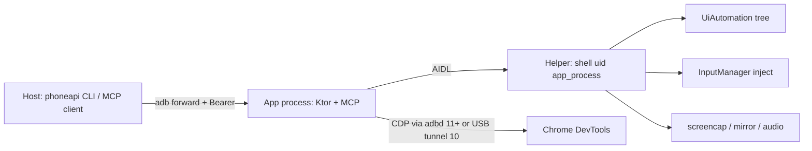

# PhoneAPI architecture

PhoneAPI is meant to feel like giving a robot their first cell phone: install the app, plug it in, and use it. The robot has neither eyes nor fingers, so the app has to help it see the screen and act without asking a human to babysit each step.

Seeing is primarily by way of a structured UI tree (Android's a11y tree or Chrome's AX tree). Screenshots are available a last resort for the client to give to its own vision model. Input looks like what a person would do: real touchscreen events with slight randomization on position and timing and typing that prefers tapping keys over dumping text into a field.

A small helper daemon runs as the `shell` user (uid 2000) via `app_process`, usually started with `phoneapi helper` over `adb shell` (or restarted later over Wireless Debugging). The `shell` user isn't root, but does have significantly elevated permissions over what a normal app is allowed to do.

## Overview



| Piece | Role |
| --- | --- |
| **`app/`** | Settings UI, `ListenerService`, Ktor REST/WebSocket/MCP on an abstract local socket, token store, CDP orchestration, encoders, viewer assets |
| **`helper/`** | Separate `app_process` as shell UID: UiAutomation snapshots, motion/key injection, screencap, display mirror, DevTools socket relay, logcat |
| **`api-model/`** | Shared `@Serializable` DTOs; same types drive MCP tool schemas and `GET /v1/openapi.json` |
| **`scripts/phoneapi`** | Production client (pair, server, helper, papi, session) |
| **`scripts/phoneapi-dev`** | Repo wrapper: debug package, `.dev/pairing.json`, `setup` |

The app is plain Kotlin: `AppGraph` is the composition root. Ktor and MCP sit on a `ServerServices` boundary so routes can be tested with fakes.

## Transport: abstract socket + ADB only

The API listens on an Android **abstract** `LocalServerSocket` named after the package. A computer reaches it with:

```text
adb forward tcp:<port> localabstract:<package>
```

then talks HTTP to `http://127.0.0.1:<port>`.

`ListenerService` (foreground, `specialUse`) holds that socket. The host starts it with `phoneapi helper` (`am start-foreground-service`). `phoneapi server` only installs the `adb forward` onto that socket.

Unauthenticated or unknown Bearer tokens get an **empty 404** (no banner).

## Pairing and auth

Bearer tokens are minted over ADB (`CREATE_TOKEN` through `ShellCommandReceiver`, DUMP-protected). The shell user is already trusted, so the phone does not need an Allow dialog for that path. `phoneapi pair` writes pairing JSON (scheme `http`, host `127.0.0.1`, port, token) to `~/.config/phoneapi/pairing.json`. `phoneapi server` installs the forward from that file.

Scopes: `observe`, `control`, `browser`, `stream`, `admin`. Routes and MCP tools are gated by scope and by `capabilities` from `/v1/device`. `?access_token=` is only for WebSocket upgrades and `GET /viewer` (which sets a cookie and redirects), not for `/mcp`.

Wireless Debugging pairing on Android 11+ is a separate concept. It allows the app to self-pair so the helper and Chrome DevTools keep working without USB.

## App vs helper

Chrome’s DevTools socket and realistic input injection are not available to a normal app UID. The helper runs as `shell` (or root on some emulators) via `app_process`, registers over a protected Binder provider, and detaches with `setsid` so it survives the `adb shell` session ending. One helper runs per app package: it holds a lock on a file in `/data/local/tmp` named for the package, and a second launch for the same package exits at once. A release and a debug build each get their own helper, though Android lets only one of them hold UiAutomation at a time, so the second one's screen reads fail until the first lets go (3 idle minutes with no event subscriber).

The helper is required for UI tree, injected input, screenshots, logcat, browser CDP plumbing, and streams. Without it, capabilities shrink; wake/launch still have limited fallbacks.

Status reported on `/v1/device`: `running`, `starting`, `needs_pairing`, `needs_usb`, `stopped`.

## Seeing the screen

Primary vision is a compact tree, not a pixel dump. Format for agents looks like `[e12] button "Sign in"` with bounds and state.

- **Android UI:** helper UiAutomation (`SnapshotEngine`, refs, find, node actions). Reads trust UiAutomation's node cache for at most 500 ms, and an action ends that at once, because an app can change a node without sending an event (`NodeCacheAge`).
- **Chrome:** CDP Accessibility domain (`Accessibility.getFullAXTree`), not the DOM. The DOM is used for scroll-into-view, quads, and similar action plumbing.
- Prefer tree → find → act / tap over screenshots.
- Screenshot is helper `screencap -p`, marked as a last resort for agents.

## Input

All touches and keys go through helper InputManager injection, stamped as a real touchscreen source (not accessibility `dispatchGesture`, which newer Android can flag). Humanization (jitter, curved swipes, short holds) defaults on for person-like motion. The viewer streams live multi-touch on `WS /v1/input/pointer` instead of replaying a finished path. The socket closing cancels the gesture, which releases the touch.

`tap` injects coordinates; `ui_act` can use semantic `performAction` or resolve a ref to a real touch. Text modes: `auto` (prefer tapping keyboard keys via a11y labels when possible), `keyboard`, `keyevent`, `setText`.

## Browser / CDP

Control is raw CDP against `@chrome_devtools_remote` (and WebViews that publish DevTools), not ChromeDriver.

- **Android 11+:** the app opens Chrome’s socket through adbd (`CdpForward` / Kadb). Wireless Debugging must be available. The helper is not on this byte path.
- **Android 10:** USB forward/reverse tunnel (`phoneapi_cdp`); the helper connects to the reverse socket and relays bytes. `phoneapi helper` sets the tunnel up.

The app owns the CDP session policy (compact AX snapshots, humanized taps through the helper, isolated-world evaluate, avoid enabling Debugger/Emulation by default). Browser tap, swipe, gesture, key, and text default to `auto`: for a caller holding the screen lease that brings the tab forward and injects a hardware event, and otherwise taps, keys, and text go over DevTools so they do not take the screen. `input=cdp` sends `Input.dispatchTouchEvent`, `Input.dispatchKeyEvent`, or `Input.insertText` to that target without bringing it forward. Chrome holds touch for any tab it is not showing on screen and plays it once the tab shows, so a cdp touch is refused unless the tab is showing; keys and text reach a background tab. `input=cdp-mouse` taps with `Input.dispatchMouseEvent`, which Chrome delivers to a background tab even while hidden. `scripts/chrome-input-check` checks this behavior against the attached phone. Reading runs `page-read.js` after Mozilla's Readability in the isolated world. The script only walks the DOM into blocks (headings, paragraphs, list items, table rows, preformatted text) with link and style runs, and reports page facts such as the HTTP status, published date, signs of a captcha, and signs of content still to load (`page-pending.js`, shared with browser snapshots). A tab Chrome is not drawing can be missing content that loads when drawn, so reads and snapshots say whether the tab was shown, and `show` brings it on screen first and waits for its text to stop growing. Chrome on Android shows a PDF in a native viewer, or saves it, so the tab's page holds no text. Before reading, Kotlin checks the main frame's URL, and for Chrome's viewer (`chrome-native://pdf/link?url=…`) `PdfReader` takes the tab over: with the Fetch domain it pauses the tab's navigation to the PDF's URL and answers it with an empty page of its own, so the navigation never reaches the network and Chrome never decides to show or save a PDF. That page has the PDF's origin, so `pdf-read.js` in it fetches the file as the site's own page would, with the site's cookies and `cache: "force-cache"`: the copy that opening the PDF left in Chrome's cache, fresh or not, so most reads make no request, and one sent `no-store` costs one same-origin request. The bytes stay in Chrome; the app never holds them. The page has no site script, so pdf.js and `pdf-read.js` run in its main world and stay there as `phoneapiPdf`, with the parsed file, until the tab navigates or closes, and later reads and finds reuse it. `PdfReader` runs script there only in a page it made, which it knows by the DevTools loader id of the load it answered; a page at the PDF's URL with any other loader is taken over again first. `page-read.js` recognizes the stand-in page by a meta tag and hands the tab back to `PdfReader`. Chrome refuses a page with no network address of its own a fetch from an `http` URL at a local or LAN address, so such a PDF is not read. A Chrome that saves PDFs rather than showing them closes a new tab once the save starts. A `url` read that loses its tab that way opens a blank tab and takes it over, which reads the saved copy from the cache, and says so in the `# opened` line. `PdfReader` keeps the last 256 such URLs in memory, so a later `url` read of one goes straight to a blank tab and Chrome does not save it again. If the URL turns out not to be a PDF, the read reports the original error. `pdf-read.js` reads pages a couple of seconds per call, so a long PDF stays within each DevTools call's time limit. It places text as the page is displayed, so a page with its own rotation reads like any other, and keeps text that runs the way most of the page's does, leaving out margin stamps and figure labels. It drops running headers, footers, and watermarks: text that repeats in the same place on many pages. It joins lines into headings, list items, paragraphs, and code by font size, spacing, and monospace fonts, and returns the same blocks as `page-read.js`. The outline comes from the PDF's bookmarks when most of them name a line on the page they point to, with each bookmark's depth as the heading level. Otherwise headings are text set larger than the body, and short standalone lines that open with a section number counting up from the one before, such as 2.4 then 2.5. pdf.js ships as ES modules and `Runtime.evaluate` runs classic scripts, so `PdfReader` drops each module's export list and wraps the rest in a function. Kotlin renders the blocks as markdown or text, so offsets, slicing, and searching are the same for `read` and `find` and are unit tested. Nothing is cached between calls; a CRC of the rendered text is returned as `version` so a caller can tell when offsets from an earlier call no longer apply. Reading data runs `page-data.js` in the same isolated world. It finds the page's JSON blobs and turns object literals in code into JSON text, so Kotlin never parses JavaScript. Only the blobs a call's paths name cross the DevTools socket, up to 2,000,000 characters. Kotlin walks that text in place (`JsonScan`), without a tree of nodes, and keeps only the slice it returns, while hashing the rest for `version`. A find holds one value's rendered text at a time. Responses a page fetches are recorded only on request (`NetworkCapture`): a DevTools session stays attached to the tab with the Network domain on and small buffer limits, and the app keeps only each JSON response's id, URL, and size. A data read fetches a body with `Network.getResponseBody` when its paths want it, within the same budget. Waits that watch requests enable Network with no buffer, since they never read a body. Streaming video/audio is for the human viewer (WebCodecs), not MCP tools. The page closes the video socket while it is hidden and the audio socket while playback is blocked.

## Host client

| Command | Job |
| --- | --- |
| `phoneapi pair` | Mint token (every scope, or `--scopes`), save pairing file (no forward, no secret on stdout) |
| `phoneapi server` | `adb forward` API socket to localhost |
| `phoneapi helper` | Start listener + helper (and Android 10 CDP tunnel) |
| `phoneapi papi` | REST / WebSocket calls, in a kept session |
| `phoneapi session` | Show or end the session `papi` keeps |
| `phoneapi-dev setup` | Debug build/install/grant/pair/server/helper for developers |

Production defaults to package `net.die.phoneapi` and `~/.config/phoneapi/`. Dev defaults to `net.die.phoneapi.dev` and `.dev/pairing.json`.

## Agent loop

The intended loop for an LLM client:

1. `ui_snapshot` / `ui_find` (tree)
2. `tap` / `ui_act` / `type_text` / `press_key`
3. `wait_for` (window / node / browser conditions)
4. `browser_read` / `browser_find` to read a page as markdown or query its JSON, and `browser_*` input when the work is in Chrome
5. `screenshot` only when the tree is not enough

MCP exposes that curated set. Token admin and media streams stay off the tool catalog, and there is no raw CDP socket: every browser action goes through a typed route or tool, so tab ownership and the isolated world always apply.

## Caveats

This stack is closer to scrcpy / wireless-debugging tooling than to a normal Play app. Expect breakage on OEM skins and new Android releases.

### Shell helper

Running a long-lived daemon as the `shell` user via `app_process` + `setsid` is non-standard. It is not an app component Android manages for you. Package updates, OEM process killers, and “USB debugging revoked” all take it down; Wireless Debugging auto-restart only covers some of that on Android 11+.

The helper’s Binder registration uses a protected ContentProvider and reflection through `ActivityManager.getService` / `IContentProvider` because a plain `ContentResolver.call` from `app_process` is rejected (no registered app identity).

### Hidden and privileged APIs

The helper calls into framework internals that apps are not supposed to use. On load it tries `VMRuntime.setHiddenApiExemptions("L")` so the targetSdk blacklist does not block those lookups. Anything in this list can move or vanish:

| Area | What we call |
| --- | --- |
| UiAutomation | `UiAutomationConnection`, hidden `UiAutomation.connect` / `disconnect` |
| Input | `ServiceManager.getService("input")`, `IInputManager.injectInputEvent` (arity varies by release) |
| Display mirror | Hidden `DisplayManager` mirror APIs; fallback `SurfaceControl.createDisplay` / `openTransaction` / `setDisplaySurface` / `destroyDisplay`, plus `DisplayManagerGlobal` |
| Audio | `REMOTE_SUBMIX` capture (`CAPTURE_AUDIO_OUTPUT`, shell-only) |
| Privileges | `WRITE_SECURE_SETTINGS`, which the app grants itself through the helper, so the app can re-enable Wireless Debugging after reboot; `DUMP` for `CREATE_TOKEN` |

Video encoding also uses `MediaFormat.KEY_LOW_LATENCY` where the codec claims support; that key is not equally real on every device.

The mirror only draws when the screen changes, so a still screen can send nothing at all. The mirror therefore draws into a `SurfaceTexture`, and a GLES relay copies each frame onto the encoder's input surface. The relay redraws the last frame when a viewer joins, so the requested key frame has input. It also redraws 100, 300, and 700 ms after the screen stops changing, so the encoder can sharpen what it blurred during motion, and then every 4 s, so a viewer can tell a still screen from a dead stream. The encoder's own `KEY_REPEAT_PREVIOUS_FRAME_AFTER` isn't used: some encoders ignore it, and the ones that honor it repeat frames ten times a second on a still screen, which costs a message each over a relay.

Each viewer has a short frame queue. When it is full, the new frame is dropped and that viewer skips delta frames until a key frame. The stream asks for one at once, and again while any viewer still waits, since a viewer still behind can drop the key frame too. The gap between requests doubles from 500 ms to 8 s, because every key frame goes to every viewer. So a slow viewer sees the picture pause rather than smear. `KEY_I_FRAME_INTERVAL` is 10 s, only a backstop. Encoders count it in frames at the configured rate, so on a screen that changes less often it is longer.

Audio packets are dropped while remote submix delivers silence, apart from 60 ms after each sound, which covers the encoder's lookahead and lets the decoder fade out. The viewer plays packets as they arrive, so a gap needs nothing on its side. Android's Opus encoder makes one 20 ms frame per packet and has no setting for longer ones, so the app joins three frames into one Opus packet (RFC 6716 code 3) and sends a 60 ms packet, a third as many messages, for 40 ms more delay. Frames join only while they share a configuration and follow on in time, and what is held goes out when silence starts. A decoder takes the joined packet like any other, so the viewer is unchanged; AAC packets go out one at a time.

Until the mirror draws once, the relay has nothing to redraw. Samsung's Android 10 SurfaceFlinger can leave a new `SurfaceControl` mirror undrawn for seconds on a still screen, so 250 ms after creating one the helper projects it two pixels short and back. That makes SurfaceFlinger draw it. The `DisplayManager` mirror isn't nudged.

### Other odd corners

- **Custom Ktor engine.** CIO only binds filesystem Unix sockets. `AbstractHttpEngine` accepts Android abstract `LocalServerSocket` connections and feeds them into CIO’s pipeline, including a reflective call into an internal `CIOApplicationCall` release method (`@InternalAPI`). When CIO closes a connection's output, the engine shuts down the socket's output too, as a TCP socket would, since Ktor's channel over an `OutputStream` only marks itself closed. Without that, a closed WebSocket stays connected: CIO reads until the client hangs up, and the client waits for the server to close first.
- **ADB is the trust boundary.** Anyone with a debugging session can mint tokens and drive the device. That is intentional; it is also why there is no LAN API anymore.
- **Chrome DevTools path is split and fragile.** Android 11+ needs Wireless Debugging (and often leaves it on). Android 10 needs a USB forward/reverse dance. Emulators sometimes need `adb root` before Chrome accepts the shell uid. Chrome itself must be publishing `@chrome_devtools_remote`.
- **Node refs are not forever.** Stable ids need Android 13+ (`ui.stableIds`); older builds synthesize refs that can churn across snapshots.
- **Humanization is best-effort.** Injected touches aim to look like a real touchscreen; apps and Play integrity can still treat “USB debugging + shell helper” as a hostile environment.
- **`FLAG_SECURE` and OEM policy.** Secure windows are black in captures; some devices further restrict shell capture, submix audio, or display mirroring.
- **Not a Store-shaped app.** Foreground `specialUse` listener, shell helper, hidden APIs, and adb provisioning are fine for sideload / enterprise; they are not a normal Play distribution story.
- **Unlock / PIN.** Stored PIN unlock taps the system keyguard UI. Layout changes, biometrics-only policies, or pattern/password locks will fail closed (`needs_user` / no keypad).

## Related docs

- What PhoneAPI is for: [README](../README.md)
- Installing a release build, pairing, and the helper: [setup.md](setup.md)
- HTTP, WebSocket, MCP, and OpenAPI: [api.md](api.md)
- Building, `phoneapi-dev`, tests and linters: [development.md](development.md)
- Sharing the phone between clients, sessions, and the screen lease: [sharing.md](sharing.md)
- What Android and Chrome were measured to do, and what is still to check on a phone: [device-notes.md](device-notes.md)
